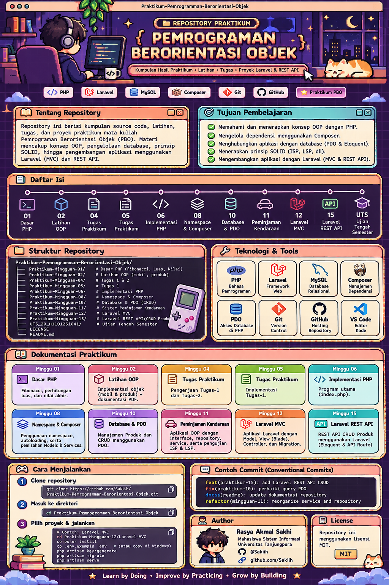

&#x20;\<div align="center">

\

# 🕹️ PRAKTIKUM PEMROGRAMAN BERORIENTASI OBJEK

### `> Building skills, one line of code at a time_`


\


**Kumpulan Praktikum · Latihan · Tugas · Implementasi OOP**

📚 Semester Perkuliahan | 💻 PHP & Laravel | 🚀 Learning Journey

\</div>

---

## 🖥️ `01. ABOUT THIS REPOSITORY`

> Welcome to my coding journey!

Repository ini merupakan kumpulan hasil pengerjaan praktikum mata kuliah **Pemrograman Berorientasi Objek (PBO)**. Di dalamnya terdapat berbagai latihan, tugas, dokumentasi, dan implementasi proyek yang dikerjakan selama proses perkuliahan.

Pembelajaran dimulai dari dasar pemrograman PHP, pengenalan konsep Object-Oriented Programming (OOP), pengelolaan database, hingga implementasi arsitektur aplikasi menggunakan Laravel.

Setiap praktikum disimpan berdasarkan minggu perkuliahan agar perkembangan pembelajaran dapat terdokumentasi dengan baik dan mudah ditelusuri.

### 🎮 Learning Roadmap

| Level | Materi               | Fokus                              |
| :---: | -------------------- | ---------------------------------- |
|   01  | PHP Fundamentals     | Dasar pemrograman                  |
|   02  | OOP Practice         | Latihan objek dan produk           |
| 04–06 | PHP Exercises        | Tugas dan implementasi PHP         |
|   08  | Namespace & Composer | Struktur kode dan autoloading      |
|   10  | Database & PDO       | Koneksi database dan CRUD          |
|   11  | SOLID Principles     | Repository, Service, dan Interface |
|   12  | Laravel MVC          | Pengembangan aplikasi berbasis MVC |
|   15  | Laravel REST API     | Pengembangan API dan CRUD          |

---

## 🎯 `02. LEARNING OBJECTIVES`

Beberapa tujuan pembelajaran yang menjadi fokus dalam repository ini:

- Memahami konsep dasar Object-Oriented Programming.
- Menerapkan class, object, property, dan method dalam PHP.
- Memahami namespace dan autoloading menggunakan Composer.
- Mengelola database menggunakan PDO dan Eloquent ORM.
- Mengimplementasikan operasi CRUD.
- Memahami interface dan prinsip SOLID.
- Menerapkan pemisahan tanggung jawab melalui Models, Services, dan Repositories.
- Memahami arsitektur Model-View-Controller (MVC).
- Mengembangkan REST API menggunakan Laravel.
- Menggunakan Git dan GitHub untuk mengelola perkembangan proyek.

---

## 🗂️ `03. REPOSITORY DIRECTORY`

Berikut gambaran struktur utama repository:

```text
Praktikum-Pemrogramman-Berorientasi-Objek/
│
├── Praktikum-Mingguan-01/
├── Praktikum-Mingguan-02/
├── Praktikum-Mingguan-04/
├── Praktikum-Mingguan-05/
├── Praktikum-Mingguan-06/
├── Praktikum-Mingguan-08/
│   └── php-namespace/
│
├── Praktikum-Mingguan-10/
│   ├── Manajemen_Produk/
│   └── latihan_pdo/
│
├── Praktikum-Mingguan-11/
│   └── PeminjamanKendaraan/
│
├── Praktikum-Mingguan-12/
│   └── Laravel-MVC/
│
├── Praktikum-Mingguan-15/
│   └── rest-api/
│
├── UTS_20_H1101251041/
│
├── LICENSE
└── README.md
```

\<details> \<summary>📂 \<b>View Complete Repository Structure\</b>\</summary>

```text
Praktikum-Pemrogramman-Berorientasi-Objek/
│
├── Praktikum-Mingguan-01/
│   ├── Fibonacci.php
│   ├── LuasPP.php
│   ├── LuasPersegiPanjang.php
│   └── NilaiAkhir.php
│
├── Praktikum-Mingguan-02/
│   ├── .gitkeep
│   ├── PPBO_2_Rasya Akmal Sakhi_H1101251041.pdf
│   ├── mobil.php
│   └── produk.php
│
├── Praktikum-Mingguan-04/
│   ├── Tugas-1.php
│   └── Tugas-2.php
│
├── Praktikum-Mingguan-05/
│   ├── .gitkeep
│   └── Tugas-1.php
│
├── Praktikum-Mingguan-06/
│   ├── .gitkeep
│   └── index.php
│
├── Praktikum-Mingguan-08/
│   └── php-namespace/
│       ├── LICENSE
│       ├── README.md
│       ├── composer.json
│       ├── index.php
│       ├── indexSebelumMenggunakanTry&Catch.md
│       ├── src/
│       │   ├── Models/
│       │   │   ├── Product.php
│       │   │   └── User.php
│       │   └── Services/
│       │       ├── ProductService.php
│       │       └── UserService.php
│       └── vendor/
│           ├── autoload.php
│           └── composer/
│               ├── ClassLoader.php
│               ├── LICENSE
│               ├── autoload_classmap.php
│               ├── autoload_namespaces.php
│               ├── autoload_psr4.php
│               ├── autoload_real.php
│               └── autoload_static.php
│
├── Praktikum-Mingguan-10/
│   ├── Manajemen_Produk/
│   │   ├── DatabaseConnection.php
│   │   ├── Product.php
│   │   ├── database.sql
│   │   └── index.php
│   │
│   └── latihan_pdo/
│       ├── CRUD/
│       │   ├── create.php
│       │   ├── delete.php
│       │   ├── read.php
│       │   ├── readall.php
│       │   └── update.php
│       ├── Catatan.php
│       ├── DatabaseConnection.php
│       └── test.php
│
├── Praktikum-Mingguan-11/
│   └── PeminjamanKendaraan/
│       ├── README.md
│       ├── composer.json
│       ├── main.php
│       ├── bin/
│       │   └── main.php
│       ├── src/
│       │   ├── Calculators/
│       │   │   └── KalkulatorSewaHarian.php
│       │   ├── Contracts/
│       │   │   ├── KalkulatorSewaInterface.php
│       │   │   ├── KendaraanRepositoryInterface.php
│       │   │   ├── PelangganRepositoryInterface.php
│       │   │   └── PeminjamanRepositoryInterface.php
│       │   ├── Models/
│       │   │   ├── Kendaraan.php
│       │   │   ├── Pelanggan.php
│       │   │   └── Peminjaman.php
│       │   ├── Repositories/
│       │   │   └── InMemory/
│       │   │       ├── KendaraanRepository.php
│       │   │       ├── PelangganRepository.php
│       │   │       ├── PelangganRepositoryAlternatif.php
│       │   │       └── PeminjamanRepository.php
│       │   └── Services/
│       │       └── PeminjamanService.php
│       ├── tests/
│       │   ├── test_isp.php
│       │   └── test_lsp.php
│       └── vendor/
│           ├── autoload.php
│           └── composer/
│               ├── ClassLoader.php
│               ├── LICENSE
│               ├── autoload_classmap.php
│               ├── autoload_namespaces.php
│               ├── autoload_psr4.php
│               ├── autoload_real.php
│               └── autoload_static.php
│
├── Praktikum-Mingguan-12/
│   └── Laravel-MVC/
│       ├── .editorconfig
│       ├── .env.example
│       ├── .gitattributes
│       ├── .gitignore
│       ├── .npmrc
│       ├── AGENTS.md
│       ├── CLAUDE.md
│       ├── README.md
│       ├── app/
│       │   ├── Http/Controllers/
│       │   │   ├── Controller.php
│       │   │   └── HelloController.php
│       │   ├── Models/
│       │   │   ├── Mahasiswa.php
│       │   │   └── User.php
│       │   └── Providers/
│       │       └── AppServiceProvider.php
│       ├── artisan
│       ├── bootstrap/
│       │   ├── app.php
│       │   ├── cache/.gitignore
│       │   └── providers.php
│       ├── composer.json
│       ├── composer.lock
│       ├── config/
│       │   ├── app.php
│       │   ├── auth.php
│       │   ├── cache.php
│       │   ├── database.php
│       │   ├── filesystems.php
│       │   ├── logging.php
│       │   ├── mail.php
│       │   ├── queue.php
│       │   ├── services.php
│       │   └── session.php
│       ├── database/
│       │   ├── .gitignore
│       │   ├── factories/UserFactory.php
│       │   ├── migrations/
│       │   │   ├── 0001_01_01_000000_create_users_table.php
│       │   │   ├── 0001_01_01_000001_create_cache_table.php
│       │   │   ├── 0001_01_01_000002_create_jobs_table.php
│       │   │   └── 2026_11_01_143458_create_mahasiswas_table.php
│       │   └── seeders/DatabaseSeeder.php
│       ├── package.json
│       ├── phpunit.xml
│       ├── public/
│       │   ├── .htaccess
│       │   ├── favicon.ico
│       │   ├── index.php
│       │   └── robots.txt
│       ├── resources/
│       │   ├── css/app.css
│       │   ├── js/app.js
│       │   └── views/
│       │       ├── hello.blade.php
│       │       └── welcome.blade.php
│       ├── routes/
│       │   ├── console.php
│       │   └── web.php
│       ├── storage/
│       │   ├── app/.gitignore
│       │   ├── app/private/.gitignore
│       │   ├── app/public/.gitignore
│       │   ├── framework/.gitignore
│       │   ├── framework/cache/.gitignore
│       │   ├── framework/cache/data/.gitignore
│       │   ├── framework/cache/locks/.gitignore
│       │   ├── framework/sessions/.gitignore
│       │   ├── framework/testing/.gitignore
│       │   ├── framework/views/.gitignore
│       │   └── logs/.gitignore
│       ├── tests/
│       │   ├── Feature/ExampleTest.php
│       │   ├── TestCase.php
│       │   └── Unit/ExampleTest.php
│       └── vite.config.js
│
├── Praktikum-Mingguan-15/
│   └── rest-api/
│       ├── .editorconfig
│       ├── .env.example
│       ├── .gitattributes
│       ├── .gitignore
│       ├── .npmrc
│       ├── AGENTS.md
│       ├── CLAUDE.md
│       ├── README.md
│       ├── app/
│       │   ├── Http/Controllers/
│       │   │   ├── Controller.php
│       │   │   └── ProductController.php
│       │   ├── Models/
│       │   │   ├── Product.php
│       │   │   └── User.php
│       │   └── Providers/AppServiceProvider.php
│       ├── artisan
│       ├── bootstrap/
│       │   ├── app.php
│       │   ├── cache/.gitignore
│       │   └── providers.php
│       ├── composer.json
│       ├── composer.lock
│       ├── config/
│       │   ├── app.php
│       │   ├── auth.php
│       │   ├── cache.php
│       │   ├── database.php
│       │   ├── filesystems.php
│       │   ├── logging.php
│       │   ├── mail.php
│       │   ├── queue.php
│       │   ├── sanctum.php
│       │   ├── services.php
│       │   └── session.php
│       ├── database/
│       │   ├── .gitignore
│       │   ├── factories/UserFactory.php
│       │   ├── migrations/
│       │   │   ├── 0001_01_01_000000_create_users_table.php
│       │   │   ├── 0001_01_01_000001_create_cache_table.php
│       │   │   ├── 0001_01_01_000002_create_jobs_table.php
│       │   │   ├── 2026_11_17_071158_create_personal_access_tokens_table.php
│       │   │   ├── 2026_11_17_071256_create_products_table.php
│       │   │   └── 2026_11_17_075529_add_product_fields_to_products_table.php
│       │   └── seeders/DatabaseSeeder.php
│       ├── package.json
│       ├── phpunit.xml
│       ├── public/
│       │   ├── .htaccess
│       │   ├── favicon.ico
│       │   ├── index.php
│       │   └── robots.txt
│       ├── resources/
│       │   ├── css/app.css
│       │   ├── js/app.js
│       │   └── views/welcome.blade.php
│       ├── routes/
│       │   ├── api.php
│       │   ├── console.php
│       │   └── web.php
│       ├── storage/
│       │   ├── app/.gitignore
│       │   ├── app/private/.gitignore
│       │   ├── app/public/.gitignore
│       │   ├── framework/.gitignore
│       │   ├── framework/cache/.gitignore
│       │   ├── framework/cache/data/.gitignore
│       │   ├── framework/cache/locks/.gitignore
│       │   ├── framework/sessions/.gitignore
│       │   ├── framework/testing/.gitignore
│       │   ├── framework/views/.gitignore
│       │   └── logs/.gitignore
│       ├── tests/
│       │   ├── Feature/ExampleTest.php
│       │   ├── TestCase.php
│       │   └── Unit/ExampleTest.php
│       └── vite.config.js
│
├── UTS_20_H1101251041/
│   └── UTS_20_H1101251041.php
│
├── LICENSE
└── README.md
```

\</details>

---

## 📚 `04. PRACTICUM ARCHIVE`

### 🟣 WEEK 01 — PHP Fundamentals

**Folder:** `Praktikum-Mingguan-01/`

Latihan dasar pemrograman PHP yang mencakup logika, perhitungan, dan pengolahan data.

| File                     | Materi                 |
| ------------------------ | ---------------------- |
| `Fibonacci.php`          | Deret Fibonacci        |
| `LuasPP.php`             | Perhitungan luas       |
| `LuasPersegiPanjang.php` | Luas persegi panjang   |
| `NilaiAkhir.php`         | Pengolahan nilai akhir |

### 🔵 WEEK 02 — OOP Practice

**Folder:** `Praktikum-Mingguan-02/`

Berisi implementasi latihan dengan konteks objek mobil dan produk, disertai dokumentasi praktikum.

- `mobil.php`
- `produk.php`
- `PPBO_2_Rasya Akmal Sakhi_H1101251041.pdf`

### 🟠 WEEK 04 — Programming Exercises

**Folder:** `Praktikum-Mingguan-04/`

Kumpulan pengerjaan tugas praktikum:

- `Tugas-1.php`
- `Tugas-2.php`

### 🟢 WEEK 05 — Programming Exercises

**Folder:** `Praktikum-Mingguan-05/`

Implementasi tugas praktikum dalam file `Tugas-1.php`.

### 🩵 WEEK 06 — PHP Implementation

**Folder:** `Praktikum-Mingguan-06/`

Berisi file `index.php` sebagai file utama implementasi program.

### 🟣 WEEK 08 — Namespace & Composer

**Folder:** `Praktikum-Mingguan-08/php-namespace/`

Mempelajari bagaimana namespace dan autoloading membantu mengorganisasi project PHP.

**Project Components**

| Directory       | Contents                       |
| --------------- | ------------------------------ |
| `src/Models/`   | Product dan User               |
| `src/Services/` | ProductService dan UserService |
| `vendor/`       | Composer autoloading           |

**Main Concepts**

- PHP Namespace
- Composer
- PSR-4 Autoloading
- Models dan Services
- Try-Catch

### 🔵 WEEK 10 — Database & PDO

**Folder:** `Praktikum-Mingguan-10/`

Terdiri dari dua bagian latihan.

**A. Manajemen Produk**

```text
Manajemen_Produk/
├── DatabaseConnection.php
├── Product.php
├── database.sql
└── index.php
```

Berisi implementasi pengelolaan produk dengan pemisahan class Product dan koneksi database.

**B. Latihan PDO**

```text
latihan_pdo/
├── CRUD/
│   ├── create.php
│   ├── read.php
│   ├── readall.php
│   ├── update.php
│   └── delete.php
├── Catatan.php
├── DatabaseConnection.php
└── test.php
```

Menerapkan operasi Create, Read, Update, dan Delete menggunakan PHP PDO.

### 🟠 WEEK 11 — Vehicle Rental System

**Folder:** `Praktikum-Mingguan-11/PeminjamanKendaraan/`

Implementasi sistem peminjaman kendaraan dengan struktur kode modular.

**Project Architecture**

| Layer        | Responsibility                            |
| ------------ | ----------------------------------------- |
| Models       | Kendaraan, Pelanggan, Peminjaman          |
| Contracts    | Interface untuk kalkulator dan repository |
| Calculators  | Perhitungan sewa harian                   |
| Repositories | Pengelolaan data InMemory                 |
| Services     | Logika layanan peminjaman                 |
| Tests        | Pengujian ISP dan LSP                     |

**SOLID Concepts**

- Interface Segregation Principle (ISP)
- Liskov Substitution Principle (LSP)

### 🟢 WEEK 12 — Laravel MVC

**Folder:** `Praktikum-Mingguan-12/Laravel-MVC/`

Pengenalan pengembangan aplikasi web dengan arsitektur Model-View-Controller menggunakan Laravel.

**Application Components**

| Component  | File                                    |
| ---------- | --------------------------------------- |
| Model      | `Mahasiswa.php`, `User.php`             |
| Controller | `HelloController.php`, `Controller.php` |
| Views      | `hello.blade.php`, `welcome.blade.php`  |
| Routing    | `web.php`, `console.php`                |
| Database   | Migrations dan Seeder                   |

**Main Concepts**

- Laravel Framework
- Model-View-Controller
- Blade Template
- Routing
- Database Migration
- Database Seeder

### 🔴 WEEK 15 — Laravel REST API

**Folder:** `Praktikum-Mingguan-15/rest-api/`

Pengembangan REST API menggunakan Laravel dengan studi kasus pengelolaan produk.

**Application Structure**

```text
rest-api/
├── app/
│   ├── Http/
│   │   └── Controllers/
│   │       └── ProductController.php
│   └── Models/
│       └── Product.php
│
├── database/
│   └── migrations/
│       ├── create_products_table.php
│       └── add_product_fields_to_products_table.php
│
└── routes/
    └── api.php
```

**CRUD API Endpoints**

Base URL:

`http://127.0.0.1:8000`

| Method | Endpoint             | Description              |
| :----: | -------------------- | ------------------------ |
|   GET  | `/api/products`      | Mengambil seluruh produk |
|  POST  | `/api/products`      | Menambahkan produk       |
|   GET  | `/api/products/{id}` | Mengambil detail produk  |
|   PUT  | `/api/products/{id}` | Memperbarui produk       |
| DELETE | `/api/products/{id}` | Menghapus produk         |

**Example JSON Request**

```json
{
    "name": "Laptop ASUS",
    "price": 5000000,
    "description": "Laptop untuk kebutuhan kuliah"
}
```

**API Testing Results**

Pengujian dilakukan menggunakan EchoAPI melalui Visual Studio Code.

| Test               | HTTP Status |   Result  |
| ------------------ | :---------: | :-------: |
| GET All Products   |     200     | ✅ Success |
| POST Product       |     201     | ✅ Success |
| GET Product by ID  |     200     | ✅ Success |
| PUT Product        |     200     | ✅ Success |
| DELETE Product     |     200     | ✅ Success |
| GET After Deletion |     200     | ✅ Success |

**Technologies**

- Laravel
- PHP
- MySQL
- Eloquent ORM
- Laragon
- HeidiSQL
- EchoAPI

### 🏆 MIDTERM EXAM — UTS

**Folder:** `UTS_20_H1101251041/`

Berisi source code pengerjaan Ujian Tengah Semester:

`UTS_20_H1101251041.php`

---

## 🧰 `05. TECHNOLOGY STACK`

Tools dan teknologi yang digunakan dalam berbagai implementasi praktikum.

\<div align="center">

| Technology | Purpose             |
| ---------- | ------------------- |
|            | Bahasa pemrograman  |
|            | Backend Framework   |
|            | Database            |
|            | Dependency Manager  |
|            | Database Access     |
|            | Version Control     |
|            | Repository Hosting  |
|            | Code Editor         |
|            | Local Development   |
|            | Frontend Build Tool |
|            | PHP Testing         |

\</div>

---

## ⚙️ `06. HOW TO RUN`

### 1. Clone Repository

```bash
git clone https://github.com/Sakiih/Praktikum-Pemrogramman-Berorientasi-Objek.git
```

### 2. Enter Repository

```bash
cd Praktikum-Pemrogramman-Berorientasi-Objek
```

### 3. Choose a Practicum

Contoh menjalankan praktikum PHP:

```bash
cd Praktikum-Mingguan-01
php Fibonacci.php
```

### 4. Running Composer Projects

Untuk proyek yang menggunakan Composer:

```bash
composer install
```

Kemudian jalankan entry point sesuai dengan proyek.

### 5. Running Laravel MVC

```bash
cd Praktikum-Mingguan-12/Laravel-MVC

composer install
```

Salin konfigurasi environment:

```powershell
Copy-Item .env.example .env
```

Generate application key:

```bash
php artisan key:generate
```

Atur konfigurasi database pada file `.env`, kemudian:

```bash
php artisan migrate
php artisan serve
```

### 6. Running Laravel REST API

```bash
cd Praktikum-Mingguan-15/rest-api

composer install
```

Siapkan environment:

```powershell
Copy-Item .env.example .env
```

Konfigurasikan database pada `.env`:

```env
DB_CONNECTION=mysql
DB_HOST=127.0.0.1
DB_PORT=3306
DB_DATABASE=rest_api
DB_USERNAME=root
DB_PASSWORD=
```

Generate key dan jalankan migration:

```bash
php artisan key:generate
php artisan migrate
```

Jalankan server:

```bash
php artisan serve
```

Server berjalan pada:

```text
http://127.0.0.1:8000
```

Pengujian endpoint dapat dilakukan menggunakan EchoAPI atau HTTP client lainnya.

---

## 🌱 `07. VERSION CONTROL`

Repository ini menggunakan Git untuk melacak perkembangan setiap praktikum.

**Check repository status**

```bash
git status
```

**Stage changes**

```bash
git add .
```

**Commit changes**

```bash
git commit -m "docs(readme): update repository documentation"
```

**Push to GitHub**

```bash
git push
```

### Commit Convention

Menggunakan pola Conventional Commits:

| Type       | Purpose                                 |
| ---------- | --------------------------------------- |
| `feat`     | Menambahkan fitur                       |
| `fix`      | Memperbaiki bug                         |
| `docs`     | Memperbarui dokumentasi                 |
| `refactor` | Merapikan struktur kode                 |
| `test`     | Menambahkan atau memperbarui pengujian  |
| `chore`    | Perubahan konfigurasi atau pemeliharaan |

---

## 👨‍💻 `08. THE DEVELOPER`

\<div align="center">

### Hello, I'm Rasya! 👋

**Rasya Akmal Sakhi**

Mahasiswa Sistem Informasi
Universitas Tanjungpura

\<a href="[https://github.com/Sakiih](https://github.com/Sakiih)">
\
\</a>

\</div>

Repository ini merupakan bagian dari perjalanan saya dalam mempelajari pemrograman, mengembangkan kemampuan OOP, memahami arsitektur perangkat lunak, dan membangun aplikasi menggunakan PHP serta Laravel.

---

## 📜 `09. LICENSE`

Repository ini menggunakan lisensi **MIT License**.

Silakan baca file [LICENSE](./LICENSE) untuk mengetahui ketentuan penggunaan, modifikasi, dan distribusi kode.

---

\<div align="center">

### 🌙 END OF TRANSMISSION

```text
╔════════════════════════════════════════════╗
║                                            ║
║   LEARN BY DOING                           ║
║   IMPROVE BY PRACTICING                    ║
║   GROW BY BUILDING                         ║
║                                            ║
║   > Keep coding. Keep learning.            ║
║   > Next level unlocked...                 ║
║                                            ║
╚════════════════════════════════════════════╝
```

⭐ **Thanks for visiting my repository!**

*Made with curiosity, PHP, and lots of `;`*

\</div>
